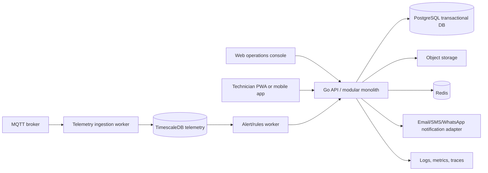

# Industrial Maintenance SaaS Product Blueprint

**Status:** Planning baseline (recommended defaults; not all commercial decisions are confirmed)  
**As of:** 18 July 2026  
**Audience:** Founders, product, UI/UX, backend, frontend, mobile, QA, DevOps, implementation partners

## 1. Executive decision

Build an **India-first maintenance-operations SaaS** for mid-sized industrial plants. Start with a CMMS (assets, work orders, preventive maintenance, procedures and spare parts), then connect plant telemetry, and only later introduce predictive analytics.

The product must not be positioned as a generic “industrial automation platform.” It must make a plant’s daily maintenance work visible, accountable and faster.

### Recommended beachhead

| Decision | Recommendation | Why |
|---|---|---|
| Initial customer | 50–500 employee discrete manufacturers with 20–200 maintainable assets | Enough maintenance complexity and budget, but less enterprise procurement friction |
| Initial sectors | Auto-component machining, packaging, food processing, textile processing | Repetitive machinery, inspections, spares and downtime pain |
| Initial buyer | Plant head, maintenance manager, owner/COO | Owns downtime, compliance and maintenance budget |
| Initial daily users | Technicians, supervisors, stores/spares users, production requesters | They create the operational data |
| Primary value promise | “Reduce missed maintenance and restore machines faster with one usable maintenance workflow.” | Concrete, measurable and credible |
| Commercial motion | Assisted implementation + paid pilot + annual SaaS | Customer data and workflow setup require help; free trials alone will not prove value |

## 2. Evidence and market context

### Verified market facts

- India’s Economic Survey reporting states MSMEs account for **35.4% of manufacturing output**, **48.58% of exports**, and **31.1% of GDP**. Source: [PIB, 29 January 2026](https://www.pib.gov.in/PressReleasePage.aspx?PRID=2219984&lang=1&reg=3).
- The Ministry of MSME dashboard lists a very large number of manufacturing registrations. This is an **upper-bound universe**, not the number of factories ready to buy CMMS. Source: [MSME dashboard](https://dashboard.msme.gov.in/).
- Leading CMMS vendors already provide work orders, preventive maintenance, asset history, parts inventory and mobile execution. Sources: [MaintainX](https://help.getmaintainx.com/), [Limble](https://limble.com/products), [Fiix](https://fiixsoftware.com/).

### Implications

1. The market is large enough, but customer selection—not top-down TAM—is the key challenge.
2. Feature parity is not a strategy. A basic asset/work-order/spares application is easy to compare and hard to sell.
3. The early advantage must be rapid local deployment, technician adoption, India-specific operating workflows and one vertical’s proven templates.

## 3. Customer problems and jobs to be done

| Job | Current workaround | Failure mode | SaaS outcome |
|---|---|---|---|
| Report a breakdown | Call/WhatsApp/verbal request | No owner, lost request, slow escalation | Traceable request and priority-based dispatch |
| Schedule maintenance | Diary, Excel or memory | PM is missed until machine fails | Recurring PM with overdue escalation |
| Repair a machine | Technician experience and paper manual | Repeat failure, inconsistent work | Procedure, history, photos and parts context |
| Find a spare part | Ask stores or call supplier | Long machine downtime | Stock, compatible assets, vendor and reorder signal |
| Prove maintenance happened | Paper sheet or signature register | Audit gap and false completion | Time-stamped checklist/evidence/audit trail |
| Understand downtime | Informal discussion | Owner cannot decide what to fix or replace | Downtime reason, cost context and repeat-failure report |
| Act on machine signal | Raw PLC/MQTT alert | Alert fatigue, no repair loop | Rule → maintenance request → closure evidence |

### Personas

| Persona | Goal | Friction | Product need |
|---|---|---|---|
| Plant head | Output and delivery reliability | Cannot see risks across line/site | Reliability dashboard, escalation and outcomes |
| Maintenance manager | Assign work and control backlog | Calls, paper and unclear ownership | Triage board, SLA, workload and PM compliance |
| Technician | Finish assigned work correctly | Missing history, part, procedure or network | Mobile/offline task, QR scan, checklist, photos |
| Stores manager | Keep critical spares available | No demand visibility or part usage record | Min/max stock, issue/return and vendor lead time |
| Production operator | Restore failed machine quickly | Does not know whom to call | Simple request form/QR/WhatsApp entry |
| Owner/COO | Reduce cost and justify investment | No trusted downtime/maintenance data | Business dashboard and monthly value report |
| External service vendor | Complete contracted service | Informal instructions and no sign-off | Scoped external work order and evidence |

## 4. Product definition and boundaries

### Product statement

`[Working name]` is a multi-tenant web and mobile maintenance-operations platform that helps industrial plants manage assets, work, procedures, spare parts, vendors and connected machine events.

### In scope

- CMMS: asset registry, work requests/orders, PM, procedures, inspection evidence
- MRO inventory: spare parts, stores, vendors, purchasing workflow later
- Reliability: downtime, failure codes, criticality and maintenance KPIs
- IIoT: managed MQTT/device ingestion, rule-based alerts, telemetry context
- Multi-site, multi-user, role-controlled B2B SaaS

### Explicit non-goals for MVP

- Replacing ERP/accounting
- Replacing MES/SCADA/PLC control systems
- Autonomous machine control
- Generic predictive maintenance claims without customer data
- Digital twins
- Full enterprise capital investment planning

## 5. Competitor map

| Platform | Core strength | Typical buyer | Important capability | What it means for us |
|---|---|---|---|---|
| MaintainX | Modern mobile-first CMMS | Maintenance teams and mid-market plants | Offline mobile, QR/barcodes, work requests/orders, PM, parts, procedures, integrations | Our technician flow must be equally simple before claiming advantage |
| Limble | Ease of use and maintenance workflow | SMB/mid-market operations | Work orders, PM, assets, inventory, analytics, mobile | Do not ship a desktop-only, data-entry-heavy product |
| Fiix | CMMS plus maintenance intelligence | Mid-market/enterprise | Work orders, assets, inventory, parts forecasting, integrations | Inventory and reporting become table stakes as accounts mature |
| UpKeep | Mobile maintenance management | Field and facility teams | Work requests, assets, work orders, mobile | Simple requester-to-technician handoff is a core UX pattern |
| eMaint/Fluke | Reliability and condition ecosystem | Industrial maintenance | Asset/work management plus reliability tooling | Sensor/condition workflows can expand after CMMS adoption |
| IBM Maximo | Enterprise EAM/APM | Large asset-intensive organizations | EAM, inspections, AI/IoT, lifecycle and investment planning | Not a first direct competitor; validates long-term category depth |
| SAP EAM / Oracle EAM | ERP-connected enterprise control | Large enterprises | Finance/procurement/compliance integration | Enterprise integration is later; do not imitate complexity in MVP |

### Competitor table stakes

These are not differentiators; customers expect them:

1. Assets, locations, hierarchy and history
2. Work requests, triage, work orders and status
3. Preventive maintenance and recurring tasks
4. Checklists/procedures, attachments and comments
5. Parts inventory and low-stock signals
6. User roles, auditability and reports
7. Mobile use, QR/barcode lookup and notifications
8. CSV import/export and APIs/integrations

### Defensible differentiation hypotheses

| Hypothesis | Test | Evidence required |
|---|---|---|
| WhatsApp-assisted request and escalation improves adoption | Pilot one plant versus existing call/WhatsApp flow | More requests captured and faster acknowledgement |
| India-specific implementation wins over generic global CMMS | Offer asset/spares import and on-site setup | Paid pilot conversion and time-to-live |
| Regional-language technician flow reduces errors | Test Hindi/Marathi/Tamil wording with technicians | Higher checklist completion and lower training time |
| MQTT/PLC alert-to-work-order loop is valuable | Integrate one existing sensor source | Fewer ignored alerts and documented closure |
| Vertical templates shorten rollout | Deliver one sector’s PM and inspection library | Faster go-live and lower configuration effort |

## 6. Complete capability catalogue

### 6.1 Foundation and tenant administration

| Capability | MVP | Later |
|---|---|---|
| Organization/tenant | Create tenant and site | Enterprise hierarchy, subsidiaries |
| Identity | OIDC login, password/MFA through identity provider | SSO/SAML, SCIM |
| Roles | Owner, admin, manager, technician, stores, requester, vendor | Fine-grained custom roles |
| Audit trail | Immutable important-event trail | Exportable compliance evidence |
| Billing | Manual invoice/contract records | Automated subscription, metering, payment |
| Data residency | India-region deployment option | Customer-managed keys/region selection |

### 6.2 Asset and location management

- Asset code, QR code, asset name, machine type, make/model, serial number
- Site → building → area → line → machine hierarchy
- Criticality, production impact, safety class and replacement value
- Warranty, vendor, manuals, diagrams, photos and document links
- Meter readings: runtime, cycles, kilometres, operating hours
- Asset status: online, planned downtime, unplanned downtime, retired
- Parent/child parts or components later

### 6.3 Work management

```text
Request → triage → work order → assign → execute → review → close → asset history
                           ↘ parts/time/cost/evidence ↗
```

- Request submitted by QR, web, mobile or approved messaging integration
- Category: breakdown, safety, quality, PM, inspection, project, calibration
- Priority, asset, location, reporter, requested time and SLA
- Planning: technician/team, due date, parts, instructions, estimated duration
- Execution: start/stop timer, checklist, readings, photos, signature, comments
- Completion: resolution code, failure cause, parts used, actual time/cost, reviewer approval
- Escalation: overdue, high priority, repeat failure and safety condition
- Parent/sub-work-order support for line shutdowns later

### 6.4 Preventive and compliance maintenance

- Calendar-based and meter-based schedules
- Templates with ordered procedures, questions, required tools/parts and safety notes
- Required evidence and conditional failure actions
- Auto-created work orders
- PM completion, overdue and exception reporting
- Calibration/inspection expiry tracking later

### 6.5 Spares, stores and purchasing

- Part number, description, unit, minimum/maximum/reorder level
- Compatible assets, substitute part and criticality
- Store/bin location, on-hand/reserved/issued quantity
- Issue, return, adjustment and stock count audit events
- Vendor/source, lead time and last price
- Requisition → approval → purchase order → receipt in phase 2

### 6.6 Vendors and external work

- Vendor contacts, sites, contracts, warranties and supported assets
- External work orders with restricted access
- Service reports, attachments, completion proof and performance score
- SLA and response-time reporting later

### 6.7 IIoT and connected maintenance

- Device registry, site/asset mapping and secret/certificate rotation
- MQTT ingestion with validated payload schema
- Store time-series telemetry separately from transactional CMMS data
- Alert rules: threshold, duration, rate-of-change, missing data and heartbeat
- Alert acknowledgement, suppression and escalation
- Link alert to request/work order and repair outcome
- No automated control command in the MVP

### 6.8 Analytics

| Metric | Definition | Decision it supports |
|---|---|---|
| PM compliance | Completed PMs ÷ due PMs | Is preventive work happening? |
| Work-order ageing | Open work by age/priority | Where is backlog risk? |
| MTTR | Repair duration average/median | How quickly are faults restored? |
| MTBF | Operating time between failures | Which assets are unreliable? |
| Downtime | Planned/unplanned duration by asset/reason | Where is production loss concentrated? |
| Repeat failure rate | Same asset/failure repeated in period | Is repair quality or root cause weak? |
| Stock-out events | Critical part unavailable when required | Is inventory driving downtime? |
| Maintenance cost | Labour + parts + external cost | Repair versus replace decisions |

## 7. UX and user-interface plan

### User experience principles

1. A technician should finish common work with one hand, low typing and minimal navigation.
2. Production users must be able to report a problem in under one minute.
3. Every screen must expose tenant/site context and role-appropriate data.
4. The product must work at poor connectivity; offline is a core requirement after MVP.
5. Use plain, localizable language; do not expose database terms to operators.
6. Colour never carries critical status alone; use icon, label and severity text.

### First screens

| Screen | Main user | Core action |
|---|---|---|
| Operations dashboard | Plant/maintenance manager | See overdue PM, critical breakdowns, backlog and spare risks |
| My work | Technician | Start/complete assigned jobs |
| Scan asset | Technician/requester | Scan QR then report issue or view history |
| Work-order detail | Technician/manager | Execute, evidence, parts/time, review |
| Asset detail | All | See status, history, PM and compatible spares |
| PM planner | Maintenance manager | Configure templates/schedules and capacity |
| Stores | Stores user | Issue/count/reorder spares |
| Alert centre | Manager/engineer | Acknowledge and convert telemetry alert to action |
| Admin setup | Tenant admin | Users, sites, roles, imports, integrations |

### Design system recommendation

- Web: responsive desktop-first operations console.
- Technician: mobile-first PWA initially; native mobile application if offline, camera and notification pilots prove material.
- Component system: accessible React components, design tokens, documented states and localisation support.
- Accessibility baseline: keyboard navigation, visible focus, high contrast, error text and touch targets suitable for gloved/industrial use where possible.

## 8. Recommended technical architecture

### Architecture principle

Use a **modular monolith** for MVP. The current Go/Echo service is retained, reorganised by business module, and deployed as one API. Split services only when a clear scale, reliability or team ownership boundary appears.



### Stack recommendation

| Layer | Recommendation | Rationale | Alternative |
|---|---|---|---|
| Backend | Go + Echo, modular packages | Existing foundation; fast, simple concurrency and MQTT fit | Go + Chi/Fiber only if team preference is strong |
| API | REST/OpenAPI first | Existing API and broad client compatibility | GraphQL later only for proven UI aggregation need |
| Web | Next.js + TypeScript + React | Mature operations-console ecosystem and strong hiring | React/Vite if SSR is not needed |
| Mobile | PWA first; React Native/Expo when native offline/camera needs justify it | Fast pilot learning without two full apps | Flutter if the team is already Flutter-native |
| Transaction DB | PostgreSQL | Strong relational model, RLS options and ecosystem | None for MVP |
| Telemetry DB | TimescaleDB on PostgreSQL | Existing direction; time-series SQL and retention | ClickHouse only at very high analytics volume |
| Cache/queues | Redis for cache/rate limits/jobs; durable queue only when needed | Small operational footprint | NATS JetStream for high-volume event streams |
| MQTT broker | EMQX or managed MQTT broker | Device auth, observability and operational features | Mosquitto for local/dev only |
| Object files | S3-compatible object storage | Durable documents/photos, signed URL access | MinIO for local/dev |
| Identity | Managed OIDC provider, recommended AWS Cognito if AWS is selected | MFA, password resets, SSO path without custom auth | Keycloak for self-hosted control |
| Hosting | Containerised API + managed Postgres in India region | Backup, scaling and secure networking | Kubernetes only after multiple services/operations need it |
| Observability | OpenTelemetry + Grafana/Prometheus + error tracking | Trace work order/ingestion failures end-to-end | Managed cloud equivalents |
| CI/CD | GitHub Actions plus migration and security checks | Common, auditable workflow | GitLab CI if repository moves there |

### Architectural modules

```text
identity/        tenants, users, roles, authorization
organizations/   tenant, site, location hierarchy
assets/          asset registry, documents, criticality, meters
work/            requests, work orders, assignment, SLA, completion
maintenance/     PM templates, procedures, schedules, inspections
inventory/       parts, stock movements, supplier relationships
vendors/         service vendors, external work, contracts
telemetry/       device registry, ingestion, readings, alerts
reporting/       operational KPIs and export jobs
files/           document metadata and signed object access
notifications/   email/SMS/WhatsApp adapter and delivery log
platform/        audit, feature flags, configuration, jobs
```

## 9. Data and tenant model

### Tenant boundary

Every business row receives `tenant_id`. Every repository query must require the tenant context. Database row-level security is recommended as a second defensive layer for shared SaaS tables.

```text
tenant
  └── site
       └── location
            └── asset
                 ├── work_order
                 ├── maintenance_schedule
                 ├── telemetry_device
                 └── asset_part
```

### Core entities

| Domain | Core entities |
|---|---|
| Identity | tenant, user, role, membership, session/audit event |
| Organisation | site, location, team, shift |
| Assets | asset, asset type, meter, document, warranty, criticality |
| Work | request, work order, assignment, status transition, labour entry, failure code, downtime event |
| Maintenance | template, procedure, step, question, response, schedule, generated task |
| Inventory | part, stock location, stock balance, stock movement, supplier part, requisition, purchase order |
| Telemetry | device, MQTT credential/certificate metadata, reading, rule, alert, alert-work link |
| Platform | notification, delivery attempt, integration connection, audit event, feature flag |

### Critical constraints

- Never use a URL parameter alone as tenant authorization.
- Every document/object key is tenant scoped and downloaded with a short-lived signed URL.
- Do not store device passwords or broker secrets in plaintext.
- Telemetry payload must be validated before write; rejected payloads go to a controlled dead-letter/audit stream.
- Use immutable audit events for security, stock movements, work-order status transitions and compliance evidence.

## 10. API and integration contract

### API standards

- REST under `/api/v1`; retain existing paths temporarily through an explicit compatibility strategy.
- OIDC bearer token verified at edge/API middleware.
- Tenant resolved from verified membership/claim, not caller-supplied body field.
- Cursor pagination for list endpoints; filtering and sorting allow-listed.
- Idempotency key for request creation, stock movement and externally retried events.
- Standard problem response: code, human message, correlation ID and safe field errors.
- OpenAPI generated in CI; breaking changes require versioning or deprecation window.

### Integrations by phase

| Phase | Integration | Purpose |
|---|---|---|
| Pilot | CSV/Excel import/export | Fast onboarding |
| Pilot | Email + optional WhatsApp adapter | Alert and escalation |
| Phase 2 | MQTT | Sensor and gateway events |
| Phase 2 | ERP purchase/export connector | Finance/procurement handoff |
| Phase 2 | SSO | Enterprise customer access |
| Later | OPC-UA/Modbus gateway adapter | OT connectivity through secure edge gateway |

## 11. Security, privacy and reliability

### Release-blocking controls

1. OIDC authentication and role-based authorization
2. Tenant isolation tests
3. MFA available for admins
4. Encryption in transit; object storage and database encryption at rest
5. Secret manager, rotation procedure and no secrets in logs
6. Audit events for privileged and compliance actions
7. Daily backups, restore test and documented RPO/RTO
8. Rate limiting, input size limits and safe file validation
9. Dependency scanning, image scanning and patch policy
10. Incident runbook and customer notification process

### Operational targets (recommended)

| Area | Pilot target | Mature target |
|---|---|---|
| API availability | 99.5% | 99.9% |
| RPO | 24 hours | 1 hour |
| RTO | 8 hours | 4 hours |
| P1 acknowledgement | Business-hours 1 hour | 15–30 minutes agreed SLA |
| Audit retention | 1 year | Contract/compliance-defined |
| Telemetry retention | 30–90 days raw | Tiered raw + aggregate retention |

## 12. Development flow

### Team workflow

```text
Customer evidence → Product requirement → UX flow → API/data contract
→ migration + backend → web/mobile → automated tests → demo environment
→ pilot feedback → measured decision → next increment
```

### Definition of ready

- Persona and user job are named.
- Problem and measurable success criterion are written.
- Tenant/role permissions are defined.
- UX states include loading, empty, error, offline and permissions.
- Data entities, API contract and migration impact are understood.
- Telemetry/notification/failure behaviour is specified when relevant.

### Definition of done

- Unit, API and tenant-isolation tests pass.
- Migration rollback path exists.
- Audit/observability/security effects are addressed.
- UI meets accessibility and mobile requirements.
- OpenAPI/docs and release notes are updated.
- Feature is demonstrated against a realistic plant scenario.

## 13. Delivery roadmap

### Phase 0 — discovery, 0–30 days

- Interview 25 decision-makers and technicians in one sector.
- Capture current workflow, downtime examples, PM completion, asset count, tools, data readiness and willingness to pay.
- Recruit five design partners and sell two paid pilots.
- Select vertical only after evidence.

### Phase 1 — paid CMMS pilot, 31–90 days

- Secure multi-tenant platform, roles, audit and onboarding
- Assets, locations, requests/work orders, PM, procedures, parts and dashboard
- Import tools, responsive technician workflow and support operations
- Baseline each pilot: downtime, overdue PM, response time, stock-out events

### Phase 2 — adoption and repeatability, months 4–6

- QR/barcodes, offline capability, vendor work, stock movements, notifications
- Vertical template package and one high-value integration
- Case studies with before/after metrics

### Phase 3 — connected maintenance, months 7–12

- Device registry, hardened MQTT ingestion, alert rules and alert-to-work order
- Multi-site reporting, procurement workflow and partner channels

### Phase 4 — intelligence, after data proof

- Reliability analysis, recommended stock and failure-risk experimentation
- Only productionise models that beat a simple rules baseline and have clear operator explanations

## 14. Metrics and commercial validation

### Product adoption

- Time to first imported asset
- Time to first created work order
- Weekly active technicians / invited technicians
- PM completion rate
- Work-order closure rate and median closure time
- Percentage of work orders with evidence/parts/time captured

### Customer value

- Unplanned downtime hours by critical asset
- MTTR and repeat failure rate
- Critical-part stock-out incidents
- Maintenance backlog ageing
- Audit preparation time
- Cost avoided or production time recovered (customer-validated)

### Business health

- Paid pilot conversion rate
- Implementation hours per live site
- Annual recurring revenue per site
- Gross margin after onboarding/support
- Net revenue retention and expansion to additional sites
- Customer support tickets per active technician

## 15. Decision register

| ID | Decision | Status | Rationale / action |
|---|---|---|---|
| D01 | Product starts CMMS-first, then IIoT | Recommended | Matches repository and customer value sequence |
| D02 | Initial target is Indian mid-market plants | Recommended | Avoids enterprise procurement and micro-business low willingness-to-pay |
| D03 | Retain Go/Echo as backend foundation | Recommended | Existing code and appropriate runtime |
| D04 | Modular monolith first | Recommended | Minimises delivery and operations complexity |
| D05 | PostgreSQL + TimescaleDB split by workload | Recommended | Transactional + telemetry fit |
| D06 | Next.js web console | Recommended | Productive TypeScript operations UI stack |
| D07 | PWA first, native mobile after validated need | Recommended | Faster pilot feedback; preserves native option |
| D08 | Managed OIDC identity | Recommended | Avoid custom security system |
| D09 | Cloud provider and India-region deployment | TBD | Choose after commercial/security constraints are known |
| D10 | Exact pricing and packaging | TBD | Establish after 5–10 discovery interviews and pilot willingness-to-pay tests |
| D11 | First industry vertical | TBD | Must be chosen from customer access and evidence |

## 16. Immediate next actions

1. Hold a 90-minute founder/product decision session to resolve D09–D11.
2. Write a 25-interview discovery script and recruit the first five design partners.
3. Create a UX flow pack for request, work order, PM, asset scan and stores issue.
4. Convert Phase 1 into epics, API contracts and data migrations.
5. Fix existing security/tenant foundations before exposing the current backend to a customer.

